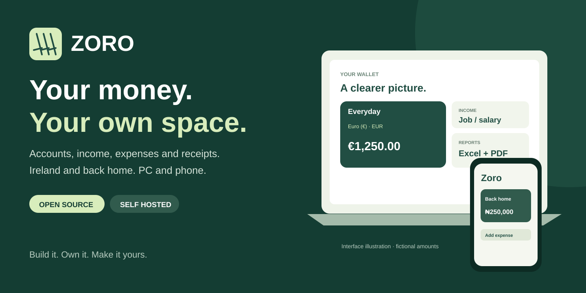
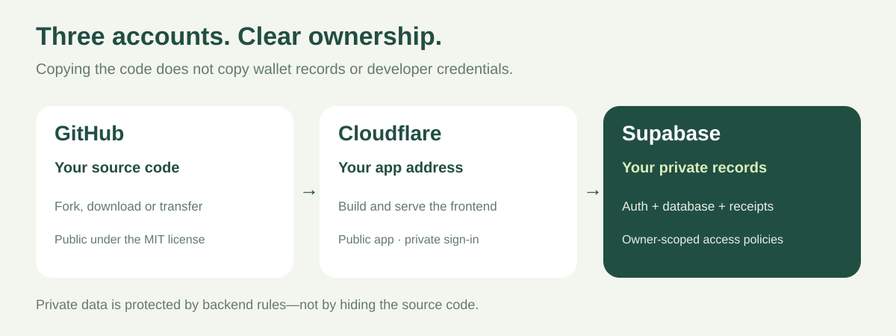
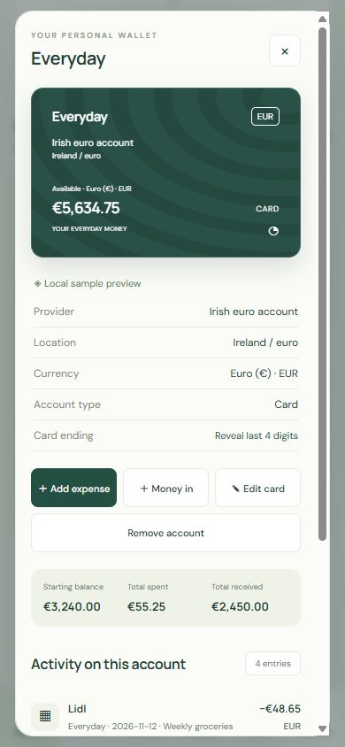

# Zoro



**Personal finance for life in Ireland and accounts back home.** Manually track accounts, cards, income, expenses, receipt photos and debts, with Excel/PDF reports and optional owner-controlled hosting.

[Try the sample app](https://zoro-personal-wallet.pages.dev/) · **[Complete setup tutorial](docs/SETUP.md)** · [Copy or transfer to your GitHub](docs/GITHUB-TRANSFER.md) · [Owner handover checklist](docs/HANDOVER-CHECKLIST.md)

## Start here

- **Just exploring?** Open the sample app. It contains fictional data and a skippable tutorial.
- **Your own wallet?** Create a verified account. Real wallets start empty. Your host must configure confirmation email delivery first.
- **Your own app and data?** Fork this repository, create your Supabase project and deploy through your Cloudflare account. Follow [the step-by-step guide](docs/SETUP.md).
- **Moving existing records?** Download a full Excel backup, restore it in the destination and verify balances and photos. [Wallet migration](docs/SETUP.md#5-move-an-existing-wallet).

## What is included

- Responsive wallet cards, custom colours/patterns and uploaded images, with currency names/symbols and euro estimates.
- Income source choices, account-specific expenses, receipt photos/notes and debts.
- Date/account/receipt-filtered Excel and PDF reports with branded headers, tables and spending graphs.
- Full Excel backup/restore, Zoro report import and backup offers before record/section/wallet/account deletion.
- Email/password/TOTP authentication, signed-in browser review and password recovery UI.
- Optional Google/SMS sign-in, PIN/device-authenticator screen locks, unfamiliar-browser approval with approximate location notices, and one-time authenticator recovery codes.
- Optional Microsoft OneDrive workbook updates and encrypted scheduled owner snapshots.

**Some services require owner configuration.** Google, SMS, SMTP, Microsoft and backup services are not activated just by forking. New database security migrations and the recovery Edge Function must be installed before their features work. [Advanced setup](docs/ADVANCED-SETUP.md) · [Current readiness and limitations](zoro/RELEASE-STATUS.md).

The app records money; it does not connect to banks or execute payments. Local locks do not replace server authentication or guarantee physical-device binding. In-app location/approval notices require an approved tab to be open; they are not operating-system push notifications.

## Your source, hosting and records



The source is public under [MIT](LICENSE). Wallet records belong in private, owner-scoped Supabase storage—not in GitHub. Project administrators can read their project's records; this is not end-to-end encrypted storage. [Security and privacy](SECURITY.md).

## Run the local sample

Requires Node.js 22 or later:

```sh
git clone https://github.com/Ranabdullah/Zoro.git
cd Zoro/zoro
npm ci
npm run setup:check
npm test
npm run build
npm start
```

Open http://127.0.0.1:4173/. Without backend variables this is a fictional, in-memory preview. A reload resets it. The application source folder is **`zoro/`**. Historical database identifiers are retained only to preserve existing wallets. A small legacy-host build forwards old deployments to the renamed source.

## Documentation

- [Complete GitHub → Supabase → Cloudflare tutorial](docs/SETUP.md)
- [Copy, download, fork or transfer the repository](docs/GITHUB-TRANSFER.md)
- [Optional sign-in, recovery, device approval, Excel sync and backups](docs/ADVANCED-SETUP.md)
- [Installation and owner handover checklist](docs/HANDOVER-CHECKLIST.md)
- [Daily use, export, import and deletion](zoro/DATA-GUIDE.md)
- [Developer/owner handover notes](zoro/HANDOVER.md)
- [Release status: implemented versus externally verified](zoro/RELEASE-STATUS.md)
- [Contributing](CONTRIBUTING.md) · [Third-party notices](THIRD-PARTY-NOTICES.md)

<p align="center"></p>

The phone image is a sample from a browser-sized preview, not evidence of physical iPhone/Android validation. Complete the [acceptance checklist](docs/HANDOVER-CHECKLIST.md) in your own deployment before relying on it for your only financial records.
