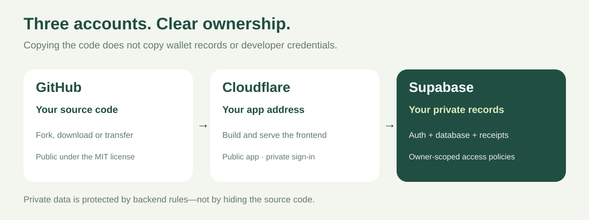

# Copy or transfer Zoro on GitHub



## Recommended: your client forks the public repository

The client opens [Ranabdullah/Zoro](https://github.com/Ranabdullah/Zoro), clicks Fork, chooses their account and creates their copy. They then connect that copy to their Cloudflare account and configure their Supabase project using [SETUP.md](SETUP.md).

You keep your original repository. They receive a source copy and can make changes. Forking does not copy production secrets, Cloudflare settings, Supabase records, logins or backups. Do not transfer your personal developer accounts.

## Download ZIP and upload to a new repository

1. Code → Download ZIP → extract.
2. Create an empty repository under the client's GitHub account.
3. Upload the extracted contents, including `.github`, `docs` and `zoro`. Keep the directory structure.
4. Retain LICENSE and third-party notices.
5. Configure Cloudflare with root `zoro`, not the ZIP wrapper folder.

A ZIP is source only. Cloudflare must run the build to generate SDK/report bundles, fonts, public configuration and the downloadable SQL. Do not upload a local working folder containing user records or credentials.

## GitHub Desktop

1. Install GitHub Desktop from GitHub's official site and let the owner sign in.
2. Clone their fork, or create a repository from the clean extracted source folder.
3. Check the Changes list before committing. Exclude exports, receipts, `.env`, node_modules and local build output ignored by this project.
4. Commit and Publish repository/Push origin to the owner's account.
5. Connect that repository in the owner's Cloudflare Pages dashboard.

## Command-line copy, without old commit history

Create a new empty GitHub repository first, then in a clean extracted ZIP folder:

```sh
git init
git add .
git commit -m "Start Zoro"
git branch -M main
git remote add origin https://github.com/YOUR-USERNAME/Zoro.git
git push -u origin main
```

Do not run these commands inside another app's repository. Use GitHub's own sign-in; never paste a token into source, a remote URL or chat.

## Transfer the existing repository itself

Use this only if you want to give away the original repository, rather than a copy. Forking is usually better when the author wants to keep maintaining the project.

1. Agree on the receiving GitHub username or organization and whether the recipient wants the existing repository/history.
2. Back up source and wallet data separately. Verify the recipient has accepted any collaborator invitations needed for the handover.
3. The current owner opens Repository → Settings → General → Danger Zone → Transfer ownership, enters the recipient and completes GitHub's confirmation. The recipient may need to accept.
4. Update local remotes to the new URL:

```sh
git remote set-url origin https://github.com/NEW-OWNER/Zoro.git
git remote -v
```

5. In the recipient's Cloudflare account, deploy a new Pages project connected to the transferred repository. Reauthorize repository access if needed. Never assume the former owner's Cloudflare integration or billing transferred.
6. Use a recipient-owned Supabase project and the full backup/restore flow. A repository transfer does not move the database, SMTP sender, app logins or storage.
7. Update Supabase callbacks to the final link. Verify signup, MFA, receipt photos, PC/phone sync and backup restore before removing old access.
8. Review Actions environments, variables, secrets, webhooks, deploy keys and collaborators. Remove old owner's service connections only after the new deployment is verified. Never share account passwords.

[GitHub's transfer instructions](https://docs.github.com/en/repositories/creating-and-managing-repositories/transferring-a-repository).

## Public code and licensing

This project uses the MIT license. Others may use, modify, redistribute and sell copies subject to its notice requirements; it does not grant exclusivity. Public code is separate from private app records. Protect records through Supabase policies, MFA and private Storage. Existing forks/downloads can remain even if a repository later becomes private.

Changing the repository's name does not rename the `zoro/` directory or SQL objects. Keep those paths for compatibility. The hosted product is Zoro.
