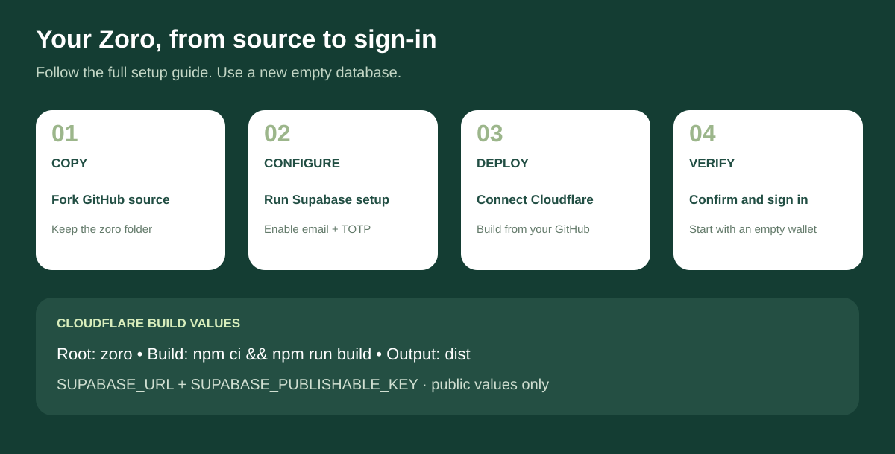
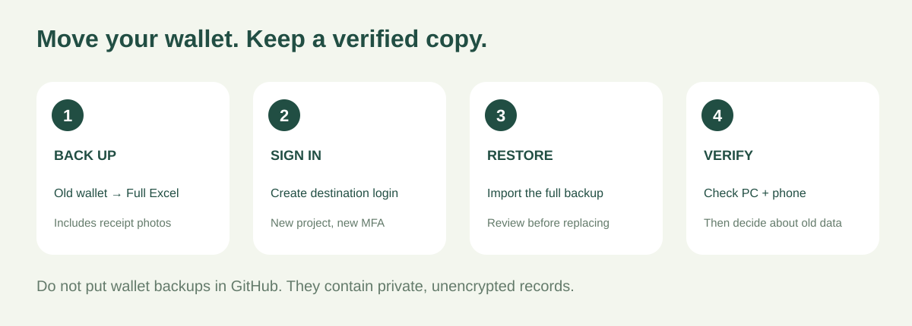

# Zoro setup: your GitHub, Supabase and Cloudflare



**Use this guide to install an independent copy.** Your GitHub holds the code, Cloudflare serves the app, and Supabase holds accounts, records and receipt photos. Creating a Supabase account alone does not install Zoro.

Allow time for email/domain verification. Service plans and dashboard labels can change. Use a new empty Supabase project; do not paste the base setup into a populated database.

## What you need

- Your own GitHub, Cloudflare and Supabase accounts.
- An authenticator app for Zoro's six-digit sign-in codes.
- A verified SMTP sender/provider for confirmation and recovery email. This is the app's sender, not the client's mailbox password.
- A computer for initial setup. Node.js 22+ is needed only for local preview/builds; Cloudflare can build directly from GitHub.

**Passwords stay with their owner.** Let the owner sign in on their computer, or use named collaborator access. A GitHub repository, Cloudflare project, Supabase project and Zoro login are four different things.

## 1. Put the source in your GitHub

### Easiest: fork

1. Open [Ranabdullah/Zoro](https://github.com/Ranabdullah/Zoro).
2. Click **Fork → Create a new fork**.
3. Choose your account, name it `Zoro`, keep `main`, then create the fork.
4. Your copy will be `https://github.com/YOUR-USERNAME/Zoro`. Forking copies code, not the original wallet database or hosting configuration.

### Alternative: download and upload

1. On the repository, choose **Code → Download ZIP**.
2. Extract it on your PC. The outer `Zoro-main` folder is only a wrapper.
3. Create a new repository in your own GitHub account.
4. Upload the *contents* of `Zoro-main`, including `.github`, `docs`, `zoro`, README and LICENSE. Do not upload the wrapper directory as another nested folder.
5. Use GitHub Desktop if hidden folders or many files make browser upload awkward. Do not include `node_modules`, `.env`, exports, real receipts or local ZIP bundles.

The app folder is still `zoro/` for compatibility. **Do not rename it during setup.** The app itself and public repository are Zoro. The package's `private: true` prevents accidental npm publishing; it does not control GitHub visibility.

See [GitHub copy and ownership transfer](GITHUB-TRANSFER.md) for GitHub Desktop, command-line copying and transferring a repository.

## 2. Create your Supabase project

1. Sign into [Supabase](https://supabase.com/dashboard) and choose **New project**.
2. Select your organization, name the project `Zoro`, choose a region and a strong database password. Save the password privately; Zoro does not need it in the browser.
3. Wait until the project is ready.
4. In your repository, open [`zoro/supabase/setup.sql`](../zoro/supabase/setup.sql). Use **Raw** or download the file, then copy the whole SQL text.
5. In Supabase, open **SQL Editor → New query**, paste it and run it **once**.
6. Confirm success. This installs owner-only vault access, a private receipt bucket, controlled saves, TOTP/session checks, public registration, deletion and optional backend choices.

The combined file includes historical `kora_*` names. They are intentional. You do **not** need `invite.sql`, an allowlisted email or an invitation. Do not run only schema.sql: the complete setup applies the public-registration and security migrations afterwards.

If setup fails partway, stop and inspect the error. Earlier sections may already be committed. For a genuinely unused project, create a fresh empty project and retry; do not delete a populated project or rerun the whole script blindly.

### Authentication settings

1. In **Authentication → Sign In / Providers**, enable Email/password registration and **Confirm email**. Set the password minimum to 12 characters or more.
2. In **Authentication → Multi-Factor**, enable TOTP. Zoro requires an authenticator before wallet data is available.
3. In **Authentication → Emails / SMTP**, configure your verified sender. Enter SMTP host, port, username, password and sender identity **directly in Supabase**. Verify the sender/domain with your email provider, including its required DNS records.
4. Keep Auth Hooks empty on a fresh project unless the guide explicitly requires otherwise. The complete SQL keeps the legacy signup hook compatible but does not require an invitation hook. Remove custom invitation/domain restrictions if you want open registration.
5. Copy the project URL and **publishable** key from the project's Connect/API settings. Only `https://YOUR-PROJECT.supabase.co` and `sb_publishable_...` go into Cloudflare.

Supabase's built-in mailer is limited to project team members. A visible Create account button is not proof that public confirmation emails work. [Official SMTP instructions](https://supabase.com/docs/guides/auth/auth-smtp).

## 3. Deploy on Cloudflare Pages

1. Sign into [Cloudflare](https://dash.cloudflare.com/).
2. Open **Workers & Pages → Create application → Continue to Pages** (or the Pages equivalent).
3. Choose **Import an existing Git repository** and connect GitHub. Grant access to your Zoro repository; you do not need access to all repositories.
4. Select **your** copy of Zoro and begin setup.
5. Choose a unique project name, for example `zoro-yourname`. The public address will be `https://zoro-yourname.pages.dev` if available.
6. Set:

```text
Framework preset       None
Production branch      main
Root directory         zoro
Build command          npm ci && npm run build
Build output directory dist
```

7. In environment/build variables add:

```text
SUPABASE_URL             https://YOUR-PROJECT.supabase.co
SUPABASE_PUBLISHABLE_KEY sb_publishable_YOUR_PUBLIC_KEY
NODE_VERSION             22
```

8. Save and deploy. Wait for a successful build; open the production pages.dev link.
9. In project settings, check that automatic production deployments from `main` are enabled. Future pushes to your repository rebuild the app.

The project uses Cloudflare's `_headers` for CSP, anti-framing, no-store and other controls. Host the **built dist** directory, not the repository root. Do not expose production variables to untrusted pull-request previews; disable those previews or use a separate test Supabase project.

[Official Cloudflare build configuration](https://developers.cloudflare.com/pages/configuration/build-configuration/).

### Finish the Supabase callback

Once the final Cloudflare address exists, return to **Supabase → Authentication → URL Configuration**:

```text
Site URL       https://YOUR-ZORO.pages.dev/
Redirect URL   https://YOUR-ZORO.pages.dev/
```

Use your exact address and trailing slash. Do not put the Supabase dashboard URL here. Add a custom domain as an additional exact redirect if you later use one, then update Site URL. Avoid broad production wildcards.

## 4. Create the first real wallet

1. Open **your Cloudflare link**. The sample wallet contains fictional records only.
2. Choose **Create an account**, use your own email, confirm the email and sign in.
3. Set up the authenticator and verify its code. Your real wallet should be empty; sample records are not copied.
4. Add a test account with EUR 100 and an expense of EUR 12.34. The balance should be EUR 87.66.
5. Add a harmless receipt photo. Open the same app link on your phone, sign into the same account and complete MFA. Confirm the balance and photo match after refreshing.
6. Use a second test login. It must start empty and must not see the first wallet.
7. Use Settings → Help for the optional tutorial. Use Settings → Data management for full Excel backup/restore.

Do not announce setup complete until confirmation email, MFA, phone/PC sync and a backup restore have been tested. [Owner handover checklist](HANDOVER-CHECKLIST.md).

## 5. Move an existing wallet



1. Sign into the **old app/backend** and open Settings → Backup, import or remove data.
2. Download **Full Excel backup**. It includes accounts, transactions, debts, card designs and receipt images. Keep it privately; it is unencrypted.
3. In the independently deployed app, create and verify a **new project login**. An identical email can be used, but passwords, user IDs, MFA and sessions are not transferred.
4. Confirm the new wallet is empty. Open Settings → Data management → Restore a full Zoro backup and choose the `.xlsx` file.
5. Review the replacement warning and confirm. Check balances, transaction counts, debts, custom cards and actual receipt images on both PC and phone.
6. Download a new backup from the destination. Only after verifying it should you remove old data if wanted. Copying does not delete the old wallet.

Financial-report Excel files contain transactions, not complete wallets. Use a **full backup** for migration. Import limit: 25 MB. Keep independent backups; online saving alone is not backup retention.

### Optional: use your own backend through the shared app

Instead of deploying your own website, you may keep using the shared Zoro link and connect your own Supabase project through Settings → Cloud connection settings. Complete the same SQL/email setup first. Authenticate to the destination project separately; after verification its public connection settings are remembered with the central Zoro ID.

This option still depends on the shared app and central login. Deploying your own fork with your project configured in Cloudflare gives you independent ownership. Returning to default cloud disconnects the choice without deleting the destination data.

## 6. Local preview and updates

```sh
git clone https://github.com/YOUR-USERNAME/Zoro.git
cd Zoro/zoro
npm ci
npm test
npm run build
npm start
```

Open http://127.0.0.1:4173/. Without backend variables this is an in-memory sample preview. It is bound to this PC, not a phone network address. Node's build script does not automatically read `.env` files.

For a configured local build in PowerShell:

```powershell
$env:SUPABASE_URL = 'https://YOUR-PROJECT.supabase.co'
$env:SUPABASE_PUBLISHABLE_KEY = 'sb_publishable_YOUR_PUBLIC_KEY'
npm run build
npm start
```

If testing email locally, separately add `http://127.0.0.1:4173/` to Supabase redirects. Keep public configuration out of committed source so new owners do not accidentally use someone else's backend. Never add a service-role key.

To update, change your own repository and push to `main`. Cloudflare rebuilds automatically. Fork users can use GitHub **Sync fork** and review changes before deploying. Read migration/release notes first; back up real data before schema changes. Do not rerun the base setup on an existing installation.

## Problems and fixes

- **No confirmation email:** check custom SMTP, verified sender/domain, spam, provider/Auth logs and rate limits. Never disable verification to work around delivery.
- **Cloudflare build says missing configuration:** add both public Supabase build variables and redeploy. Check root `zoro`, output `dist` and Node version.
- **Redirect returns to someone else's link:** fix Site URL and the exact allowed redirect in your own Supabase project.
- **Sign-in works but wallet access fails:** complete MFA, check the complete SQL was applied, and look for a revoked session. Do not disable RLS.
- **New account sees sample data:** check the Preview label. Sample mode and real account mode are separate; sign in successfully to leave preview.
- **Another device saved changes:** refresh, review current records and retry. Zoro prevents an older save overwriting newer data.
- **Wrong Excel format:** restore a full backup for a whole wallet; choose transaction-report merge for a Zoro financial report. Arbitrary Excel layouts are unsupported.
- **Private receipt does not load:** refresh the current authenticated session and check private bucket policies. Do not make the bucket public.
- **Lost authenticator:** use your authenticator's own secure recovery/backup. The Supabase owner must verify identity before any factor recovery; do not share owner credentials.

## Current boundaries

Read [RELEASE-STATUS](../zoro/RELEASE-STATUS.md) for verified features and owner-configured services. Downloaded reports are snapshots; online spreadsheet synchronization, biometric security and provider backup services must not be assumed from the presence of an export button. Data is access-controlled, not end-to-end encrypted. Project administrators can read their project's data.

## Simplest setup order

1. [Copy Zoro to your GitHub](GITHUB-TRANSFER.md).
2. Create Supabase and run [the complete setup SQL](../zoro/supabase/setup.sql).
3. Configure email/password, Confirm email, TOTP and a verified SMTP sender.
4. Connect that repository in Cloudflare using root `zoro`, build `npm ci && npm run build`, output `dist`.
5. Add the two public Supabase variables and deploy.
6. Put the new app URL into Supabase's Site URL/allowed redirects.
7. Create a test login and verify an empty wallet, PC/phone sync and a full backup/restore.
8. Enable optional integrations using [ADVANCED-SETUP.md](ADVANCED-SETUP.md) only after their owner configuration is ready.

For existing installations, apply incremental migrations instead of the base setup. The code retains historical database identifiers only for compatibility; app/repository/source naming is Zoro. An older hosting configuration can temporarily use the legacy forwarding build while its root setting is updated.
